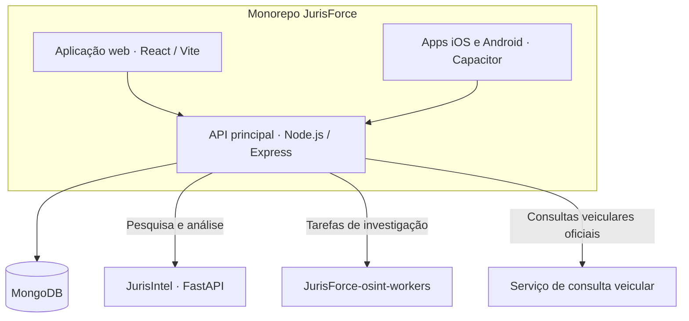

# JurisForce

A JurisForce é uma plataforma de gestão e automação jurídica para advogados e escritórios brasileiros. Reúne o trabalho do dia a dia, da organização de casos e prazos à pesquisa jurídica e à gestão do escritório.

[Conheça a JurisForce](https://jurisforce.com.br/)

## O que você pode fazer

| Área | Recursos |
| --- | --- |
| Operação | Gerencie casos, clientes, prazos e agenda. Acompanhe processos e publicações. |
| Estratégia | Pesquise jurisprudência e jurimetria e elabore teses e peças com assistência de IA. |
| Pesquisa | Faça consultas e investigações patrimoniais e visualize vínculos entre pessoas e empresas. |
| Gestão | Organize as finanças e a equipe do escritório e faça cálculos jurídicos. |

## Para a equipe

O frontend usa React, TypeScript, Vite e Tailwind CSS. A API usa Node.js, Express e MongoDB; os contratos entre frontend e API são compartilhados com Zod. Os apps iOS e Android usam Capacitor.

### Repositórios e como se conectam

Os links de repositórios privados exigem permissão no GitHub.

| Repositório | Como se conecta à JurisForce |
| --- | --- |
| [JurisForce](https://github.com/JurisForce/JurisForce) | Monorepo principal: aplicação web, apps iOS e Android, API e contratos compartilhados. |
| [JurisForce-osint-workers](https://github.com/JurisForce/JurisForce-osint-workers) | Serviço separado de investigação em fontes abertas. Quando configurado, recebe tarefas autorizadas da API principal por HTTP autenticado, sem acesso direto ao banco da aplicação. |
| [jurissync-app](https://github.com/JurisForce/jurissync-app) | Origem do JurisIntel, serviço de pesquisa e análise em FastAPI. A aplicação conversa com o JurisIntel pela API principal, não por um portal separado no navegador. |
| [jurisforce-consultas-workers](https://github.com/JurisForce/jurisforce-consultas-workers) | Catálogo e serviço de consultas públicas. Compartilha parte dos catálogos versionados com a aplicação; não foi identificada uma chamada direta da API principal a esse serviço. |
| [jurisforce-consulta-placa](https://github.com/JurisForce/jurisforce-consulta-placa) | Ferramenta autônoma de consulta por placa. Não é o serviço de consulta veicular oficial chamado pela API principal. |
| [jurisforcex-extension](https://github.com/JurisForce/jurisforcex-extension) | Extensão complementar do navegador para sincronização de processos e importações. Envia os dados a um backend configurável e inclui um receptor de referência. |
| [jurisforce-mcp-teste](https://github.com/JurisForce/jurisforce-mcp-teste) | Ambiente separado para validar o conector MCP, fora do fluxo da aplicação principal. |
| [docs](https://github.com/JurisForce/docs) e [whoami-knowledge](https://github.com/JurisForce/whoami-knowledge) | Documentação de projeto e guias internos de operação, sem dependência em tempo de execução. |

### Fluxo da aplicação

As setas mostram as chamadas em tempo de execução. O MongoDB é o banco da aplicação; JurisIntel, workers OSINT e consulta veicular são integrações configuráveis.



### Rodar a aplicação web localmente

Com acesso ao repositório da aplicação, Node.js 20, npm e Docker Compose, clone a aplicação e, na raiz, prepare o ambiente:

```sh
npm ci
npm ci --prefix server --include=dev
ln -sfn ../server/node_modules shared/node_modules
cp -n server/.env.example server/.env
```

Em `server/.env`, use um MongoDB local, configure `JWT_ACCESS_SECRET` e `JWT_REFRESH_SECRET` com valores diferentes de pelo menos 32 caracteres e mantenha `PORT=3001`. Defina `FRONTEND_URL=http://localhost:8090`, inclua essa origem em `CORS_ORIGINS` e deixe `JURISINTEL_INTERNAL_JWT_SECRET` ausente se não for usar essa integração. Não versione o arquivo `.env`.

```sh
docker compose up -d mongo
npm run dev --prefix server
```

Em outro terminal, na raiz do repositório:

```sh
API_PROXY_TARGET=http://localhost:3001 npm run dev
```

Abra [http://localhost:8090](http://localhost:8090). Esse ambiente básico não habilita integrações que dependem de serviços externos.
